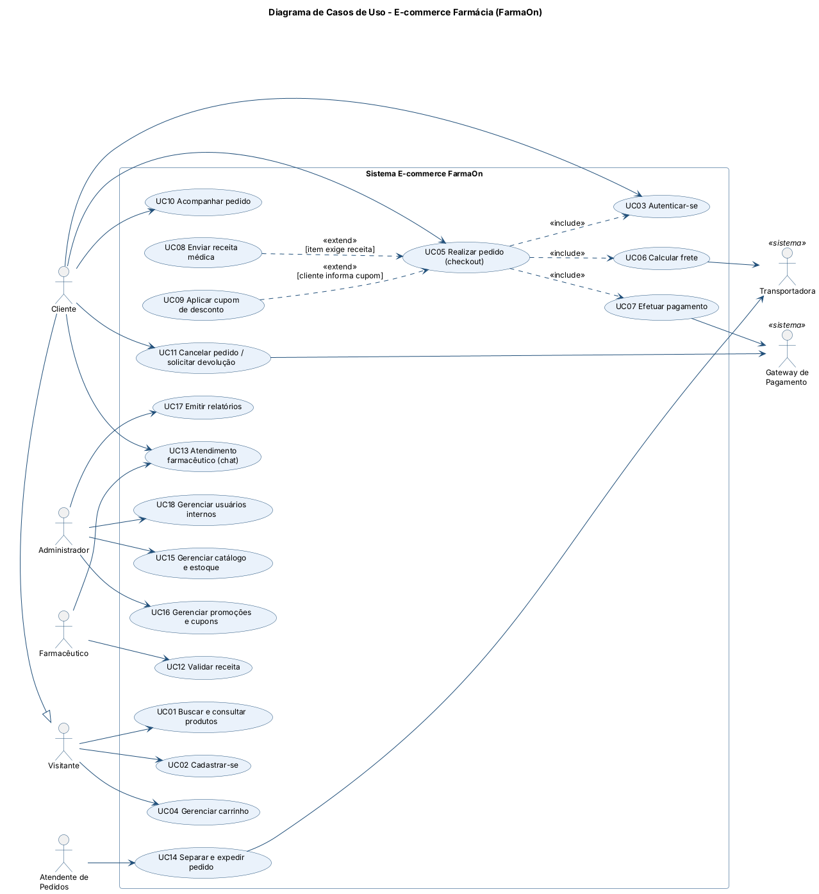

# Etapa 1 – Requisitos

## Atores

| Ator | Tipo | Descrição |
|---|---|---|
| Visitante | Primário | Pessoa não autenticada que navega no catálogo, busca produtos e monta carrinho. |
| Cliente | Primário | Visitante cadastrado e autenticado; realiza pedidos, envia receitas e acompanha entregas. Especializa Visitante. |
| Farmacêutico | Primário | Responsável técnico (CRF ativo); valida receitas e presta atendimento farmacêutico. |
| Atendente de Pedidos | Primário | Separa, confere e expede pedidos confirmados. |
| Administrador | Primário | Mantém catálogo, estoque, preços, promoções, usuários internos e relatórios. |
| Gateway de Pagamento | Secundário (sistema) | Serviço externo que autoriza, captura e estorna pagamentos (PIX, cartão, boleto). |
| Transportadora | Secundário (sistema) | API externa de cotação de frete, emissão de etiqueta e rastreamento. |

## Requisitos funcionais

| ID | Requisito | Caso de uso |
|---|---|---|
| RF01 | Buscar produtos por nome, princípio ativo, marca ou categoria, com filtros (preço, genérico, tarja) e ordenação. | UC01 |
| RF02 | Exibir página de produto com preço, estoque, bula/descrição, registro ANVISA e indicação de exigência de receita. | UC01 |
| RF03 | Cadastrar cliente (nome, CPF, e-mail, telefone, data de nascimento, endereço) com aceite da política de privacidade. | UC02 |
| RF04 | Autenticar usuário por e-mail e senha, com recuperação de senha por e-mail. | UC03 |
| RF05 | Manter carrinho (incluir, alterar quantidade, remover) para visitante e cliente, mesclando ao autenticar. | UC04 |
| RF06 | Calcular frete e prazo por CEP via API da transportadora. | UC06 |
| RF07 | Finalizar pedido com escolha de endereço, frete e forma de pagamento. | UC05 |
| RF08 | Processar pagamento por PIX, cartão de crédito (até 3x) e boleto via gateway. | UC07 |
| RF09 | Solicitar e receber upload de receita (JPG/PNG/PDF) quando o pedido contiver medicamento que a exija. | UC08 |
| RF10 | Aplicar cupom de desconto válido no checkout. | UC09 |
| RF11 | Exibir histórico e status do pedido com código de rastreio. | UC10 |
| RF12 | Permitir cancelamento antes da expedição e solicitação de devolução após a entrega. | UC11 |
| RF13 | Disponibilizar fila de receitas pendentes para o farmacêutico aprovar ou rejeitar com parecer. | UC12 |
| RF14 | Oferecer chat de atendimento farmacêutico em horário comercial. | UC13 |
| RF15 | Disponibilizar fila de separação, conferência por código de barras e geração de etiqueta de envio. | UC14 |
| RF16 | Manter cadastro de produtos, categorias, preços, lotes e validade. | UC15 |
| RF17 | Manter promoções e cupons (percentual, validade, limite de uso). | UC16 |
| RF18 | Emitir relatórios de vendas, ruptura de estoque, lotes a vencer e receitas validadas. | UC17 |
| RF19 | Manter usuários internos e perfis de acesso (farmacêutico, atendente, administrador). | UC18 |
| RF20 | Enviar notificações por e-mail a cada mudança de status do pedido. | UC10 |

## Requisitos não funcionais

| ID | Categoria | Requisito |
|---|---|---|
| RNF01 | Segurança | Tráfego exclusivamente via HTTPS (TLS 1.2+); senhas com hash bcrypt; bloqueio após 5 tentativas de login. |
| RNF02 | Privacidade | Conformidade com a LGPD (Lei 13.709/2018): consentimento, finalidade, acesso e exclusão de dados; receitas são dados sensíveis de saúde. |
| RNF03 | Pagamentos | Dados de cartão não trafegam nem são armazenados no sistema (tokenização no gateway, PCI-DSS). |
| RNF04 | Desempenho | Página de busca e de produto com tempo de resposta ≤ 2 s (p95) com 500 usuários simultâneos. |
| RNF05 | Disponibilidade | Disponibilidade mensal ≥ 99,5%, exceto janelas de manutenção programada. |
| RNF06 | Usabilidade | Checkout concluído em no máximo 4 etapas; interface aderente às 10 heurísticas de Nielsen. |
| RNF07 | Acessibilidade | Atender WCAG 2.1 nível AA (contraste, navegação por teclado, textos alternativos). |
| RNF08 | Portabilidade | Layout responsivo para desktop, tablet e smartphone (Chrome, Edge, Firefox, Safari — 2 últimas versões). |
| RNF09 | Regulatório | Atender RDC ANVISA 44/2009 (venda remota por farmácia com estabelecimento físico, farmacêutico responsável e exibição do CRF). |
| RNF10 | Auditoria | Registrar log imutável de validação de receitas (farmacêutico, data/hora, parecer) por no mínimo 5 anos. |
| RNF11 | Manutenibilidade | Cobertura de testes unitários ≥ 70% no back-end; código versionado no GitHub com revisão por pull request. |
| RNF12 | Escalabilidade | Arquitetura em camadas com API REST stateless, permitindo escalar horizontalmente o back-end. |

## Regras de negócio

| ID | Regra |
|---|---|
| RN01 | Medicamentos sujeitos a controle especial (Portaria SVS/MS 344/98, tarja preta e antimicrobianos com retenção de receita) são exibidos apenas como informativos e não podem ser comprados on-line. |
| RN02 | Medicamento de tarja vermelha com exigência de receita só é separado após aprovação da receita por farmacêutico. |
| RN03 | A receita deve estar legível, dentro da validade (30 dias da emissão, salvo indicação diversa) e conter nome do paciente, medicamento, posologia, CRM e assinatura do prescritor. |
| RN04 | A reserva de estoque dura 30 minutos; vencido o prazo sem pagamento autorizado, os itens voltam ao estoque. |
| RN05 | O pagamento é pré-autorizado no checkout e capturado somente após a aprovação da receita (ou imediatamente, se não houver receita). |
| RN06 | Receita rejeitada cancela o pedido e a pré-autorização; o cliente é notificado com o motivo. |
| RN07 | O sistema sempre expede o lote de validade mais próxima (FEFO) e bloqueia lotes vencidos ou com validade inferior a 30 dias. |
| RN08 | Somente um cupom por pedido; cupom não se aplica a medicamentos com preço regulado acima do desconto máximo permitido pela CMED. |
| RN09 | Cliente deve ter 18 anos ou mais para concluir a compra. |
| RN10 | Devolução de medicamentos só é aceita em caso de avaria, erro de separação ou desvio de qualidade (RDC 44/2009); demais produtos seguem o direito de arrependimento de 7 dias (CDC art. 49). |

## Diagrama de casos de uso

## Narrativas

### UC01 – Buscar e consultar produtos

- **Ator principal:** Visitante
- **Atores secundários:** —
- **Pré-condição:** Nenhuma.
- **Regras:** RN01

**Fluxo principal**

1. Visitante digita termo na busca ou escolhe categoria.
2. Sistema lista produtos correspondentes com foto, preço e selo de 'exige receita' quando aplicável.
3. Visitante aplica filtros e ordenação.
4. Visitante seleciona um produto.
5. Sistema exibe a página do produto (descrição, princípio ativo, registro ANVISA, preço, disponibilidade, genéricos equivalentes).

**Fluxos alternativos e de exceção**

- 2a. Nenhum resultado: sistema sugere termos semelhantes e genéricos pelo princípio ativo.
- 5a. Produto de controle especial: sistema exibe aviso de que a venda é somente presencial e oculta o botão de compra (RN01).

**Pós-condição:** Produto exibido.

### UC02 – Cadastrar-se

- **Ator principal:** Visitante
- **Atores secundários:** —
- **Pré-condição:** Visitante não possui conta.
- **Regras:** RN09

**Fluxo principal**

1. Visitante seleciona 'Criar conta'.
2. Sistema exibe formulário (nome, CPF, e-mail, telefone, data de nascimento, senha, CEP/endereço).
3. Visitante preenche e aceita os termos de uso e a política de privacidade.
4. Sistema valida dados (CPF válido e único, e-mail único, idade ≥ 18, força da senha).
5. Sistema cria a conta e envia e-mail de confirmação.

**Fluxos alternativos e de exceção**

- 4a. Dado inválido: sistema destaca o campo e a mensagem de correção, preservando os demais.
- 4b. CPF ou e-mail já cadastrado: sistema oferece 'Entrar' ou 'Recuperar senha'.

**Pós-condição:** Conta criada; cliente autenticado.

### UC03 – Autenticar-se

- **Ator principal:** Cliente
- **Atores secundários:** —
- **Pré-condição:** Cliente possui conta ativa.
- **Regras:** —

**Fluxo principal**

1. Cliente informa e-mail e senha.
2. Sistema valida credenciais.
3. Sistema inicia sessão e mescla o carrinho do visitante ao do cliente.

**Fluxos alternativos e de exceção**

- 2a. Credencial inválida: mensagem genérica; após 5 falhas a conta é bloqueada por 15 min (RNF01).
- 1a. Esqueci a senha: sistema envia link de redefinição válido por 1 h.

**Pós-condição:** Sessão autenticada.

### UC04 – Gerenciar carrinho

- **Ator principal:** Visitante
- **Atores secundários:** —
- **Pré-condição:** Produto disponível para venda on-line.
- **Regras:** RN01

**Fluxo principal**

1. Visitante clica em 'Adicionar ao carrinho'.
2. Sistema verifica estoque e adiciona o item.
3. Visitante altera quantidades ou remove itens.
4. Sistema recalcula subtotal e sinaliza itens que exigirão receita.

**Fluxos alternativos e de exceção**

- 2a. Quantidade maior que o estoque: sistema limita ao disponível e informa.
- 2b. Limite de unidades por CPF para o medicamento atingido: sistema informa o limite.

**Pós-condição:** Carrinho atualizado.

### UC05 – Realizar pedido (checkout)

- **Ator principal:** Cliente
- **Atores secundários:** Gateway de Pagamento, Transportadora
- **Pré-condição:** Cliente autenticado com carrinho não vazio.
- **Regras:** RN02, RN04, RN05, RN09

**Fluxo principal**

1. Cliente seleciona 'Finalizar compra'.
2. Sistema reserva o estoque por 30 min (RN04).
3. Cliente confirma ou cadastra o endereço de entrega.
4. Sistema calcula opções de frete (UC06) e cliente escolhe uma.
5. Cliente informa cupom, se houver (extensão UC09).
6. Cliente escolhe a forma de pagamento e confirma (UC07).
7. Se houver item que exige receita, sistema solicita a receita (extensão UC08).
8. Sistema registra o pedido, exibe o número e envia e-mail de confirmação.

**Fluxos alternativos e de exceção**

- 2a. Item sem estoque: sistema remove/ajusta e volta ao carrinho.
- 6a. Pagamento recusado: sistema permite nova tentativa ou outra forma; após 3 recusas libera a reserva.
- 7a. Cliente não envia a receita em 24 h: pedido cancelado e pré-autorização liberada.

**Pós-condição:** Pedido em PAGAMENTO_AUTORIZADO, EM_VALIDACAO_RECEITA ou CONFIRMADO.

### UC06 – Calcular frete

- **Ator principal:** Cliente
- **Atores secundários:** Transportadora
- **Pré-condição:** CEP informado.
- **Regras:** —

**Fluxo principal**

1. Sistema envia CEP, peso e dimensões à API da transportadora.
2. Transportadora retorna modalidades, valores e prazos.
3. Sistema exibe as opções, incluindo retirada na loja.

**Fluxos alternativos e de exceção**

- 2a. API indisponível: sistema aplica tabela de contingência por faixa de CEP.

**Pós-condição:** Opções de frete exibidas.

### UC07 – Efetuar pagamento

- **Ator principal:** Cliente
- **Atores secundários:** Gateway de Pagamento
- **Pré-condição:** Pedido criado com valor total definido.
- **Regras:** RN05

**Fluxo principal**

1. Cliente escolhe PIX, cartão ou boleto.
2. Sistema envia a solicitação ao gateway (cartão tokenizado).
3. Gateway retorna autorização.
4. Sistema registra o pagamento como AUTORIZADO.

**Fluxos alternativos e de exceção**

- 1a. PIX: sistema exibe QR Code válido por 30 min.
- 1b. Boleto: vencimento em 2 dias úteis; reserva estendida até a compensação.
- 3a. Recusa: sistema informa motivo genérico.

**Pós-condição:** Pagamento autorizado ou recusado.

### UC08 – Enviar receita médica

- **Ator principal:** Cliente
- **Atores secundários:** —
- **Pré-condição:** Pedido contém medicamento com exigência de receita.
- **Regras:** RN03

**Fluxo principal**

1. Sistema solicita a receita e exibe orientações (legibilidade, validade).
2. Cliente envia foto ou PDF (até 10 MB).
3. Sistema armazena o arquivo criptografado, gera protocolo e põe o pedido em EM_VALIDACAO_RECEITA.

**Fluxos alternativos e de exceção**

- 2a. Formato ou tamanho inválido: sistema rejeita e orienta.
- 2b. Cliente usa receita já enviada e ainda válida: seleciona do histórico.

**Pós-condição:** Receita PENDENTE na fila do farmacêutico.

### UC09 – Aplicar cupom de desconto

- **Ator principal:** Cliente
- **Atores secundários:** —
- **Pré-condição:** Checkout em andamento.
- **Regras:** RN08

**Fluxo principal**

1. Cliente digita o código do cupom.
2. Sistema valida (vigência, limite de uso, elegibilidade dos itens).
3. Sistema aplica o desconto e recalcula o total.

**Fluxos alternativos e de exceção**

- 2a. Cupom inválido ou expirado: mensagem e total inalterado.

**Pós-condição:** Desconto aplicado.

### UC10 – Acompanhar pedido

- **Ator principal:** Cliente
- **Atores secundários:** Transportadora
- **Pré-condição:** Cliente possui pedido.
- **Regras:** —

**Fluxo principal**

1. Cliente acessa 'Meus pedidos'.
2. Sistema lista os pedidos com status e linha do tempo.
3. Cliente abre um pedido e visualiza itens, pagamento, status da receita e rastreio.

**Fluxos alternativos e de exceção**

- 3a. Receita rejeitada: sistema exibe o parecer do farmacêutico.

**Pós-condição:** Status consultado.

### UC11 – Cancelar pedido / solicitar devolução

- **Ator principal:** Cliente
- **Atores secundários:** Gateway de Pagamento
- **Pré-condição:** Pedido existente.
- **Regras:** RN10

**Fluxo principal**

1. Cliente seleciona 'Cancelar' (antes da expedição) ou 'Devolver' (após entrega).
2. Sistema solicita o motivo.
3. Sistema cancela o pedido e solicita estorno ao gateway, ou abre a solicitação de devolução.

**Fluxos alternativos e de exceção**

- 1a. Pedido já despachado: cancelamento indisponível; somente devolução após a entrega.
- 3a. Medicamento sem avaria: devolução negada conforme RN10.

**Pós-condição:** Pedido CANCELADO ou EM_DEVOLUCAO.

### UC12 – Validar receita

- **Ator principal:** Farmacêutico
- **Atores secundários:** —
- **Pré-condição:** Farmacêutico autenticado; receita PENDENTE.
- **Regras:** RN02, RN03, RN06

**Fluxo principal**

1. Farmacêutico abre a fila de receitas (ordenada por antiguidade).
2. Sistema exibe a imagem da receita ao lado dos itens do pedido.
3. Farmacêutico confere requisitos (RN03) e aprova.
4. Sistema registra o parecer no log de auditoria, captura o pagamento e muda o pedido para CONFIRMADO.

**Fluxos alternativos e de exceção**

- 3a. Receita ilegível: farmacêutico solicita nova imagem; pedido permanece pendente.
- 3b. Receita inválida: farmacêutico rejeita com motivo; sistema cancela o pedido (RN06).

**Pós-condição:** Receita APROVADA ou REJEITADA com registro de auditoria.

### UC13 – Atendimento farmacêutico (chat)

- **Ator principal:** Cliente
- **Atores secundários:** Farmacêutico
- **Pré-condição:** Horário de atendimento.
- **Regras:** —

**Fluxo principal**

1. Cliente abre o chat.
2. Sistema encaminha ao farmacêutico disponível.
3. Farmacêutico orienta; a conversa é registrada.

**Fluxos alternativos e de exceção**

- 2a. Fora do horário: sistema registra a dúvida e responde por e-mail.

**Pós-condição:** Atendimento registrado.

### UC14 – Separar e expedir pedido

- **Ator principal:** Atendente de Pedidos
- **Atores secundários:** Transportadora
- **Pré-condição:** Pedido CONFIRMADO.
- **Regras:** RN07

**Fluxo principal**

1. Atendente abre a fila de separação.
2. Sistema indica os lotes por FEFO (RN07).
3. Atendente confere os itens por leitura de código de barras.
4. Sistema gera nota fiscal e etiqueta via transportadora.
5. Atendente marca como despachado; sistema envia o rastreio ao cliente.

**Fluxos alternativos e de exceção**

- 3a. Divergência na leitura: sistema bloqueia a conclusão até correção.

**Pós-condição:** Pedido DESPACHADO.

### UC15 – Gerenciar catálogo e estoque

- **Ator principal:** Administrador
- **Atores secundários:** —
- **Pré-condição:** Administrador autenticado.
- **Regras:** RN01, RN07

**Fluxo principal**

1. Administrador cadastra/edita produto (dados regulatórios, preço, categoria, tarja).
2. Administrador registra entrada de lotes com validade.
3. Sistema atualiza disponibilidade.

**Fluxos alternativos e de exceção**

- 1a. Registro ANVISA ausente para medicamento: sistema impede publicação.

**Pós-condição:** Catálogo atualizado.

### UC16 – Gerenciar promoções e cupons

- **Ator principal:** Administrador
- **Atores secundários:** —
- **Pré-condição:** Administrador autenticado.
- **Regras:** RN08

**Fluxo principal**

1. Administrador define desconto, vigência, limite e itens elegíveis.
2. Sistema valida contra o preço máximo permitido e publica.

**Fluxos alternativos e de exceção**

- 2a. Desconto conflita com regra: sistema alerta e impede.

**Pós-condição:** Cupom/promoção ativo.

### UC17 – Emitir relatórios

- **Ator principal:** Administrador
- **Atores secundários:** —
- **Pré-condição:** Administrador autenticado.
- **Regras:** —

**Fluxo principal**

1. Administrador escolhe o relatório e o período.
2. Sistema gera e permite exportar em PDF/CSV.

**Fluxos alternativos e de exceção**

- 2a. Sem dados no período: sistema informa.

**Pós-condição:** Relatório gerado.

### UC18 – Gerenciar usuários internos

- **Ator principal:** Administrador
- **Atores secundários:** —
- **Pré-condição:** Administrador autenticado.
- **Regras:** —

**Fluxo principal**

1. Administrador cadastra usuário interno e atribui o perfil.
2. Para farmacêutico, informa CRF e UF.
3. Sistema envia convite de primeiro acesso.

**Fluxos alternativos e de exceção**

- 2a. CRF já vinculado a outro usuário: sistema impede.

**Pós-condição:** Usuário interno ativo.
