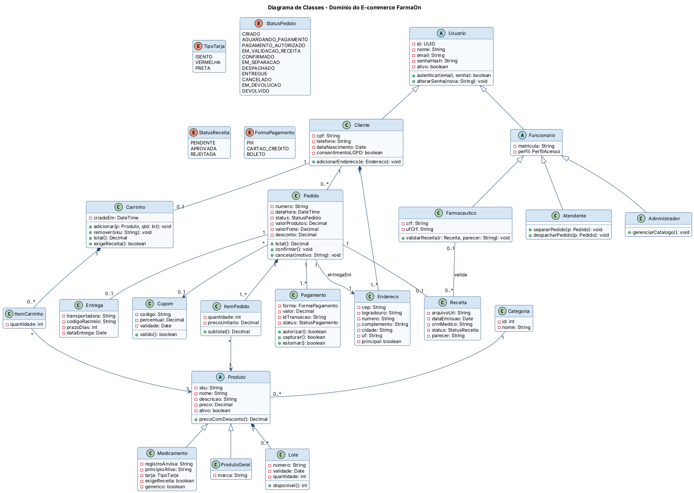
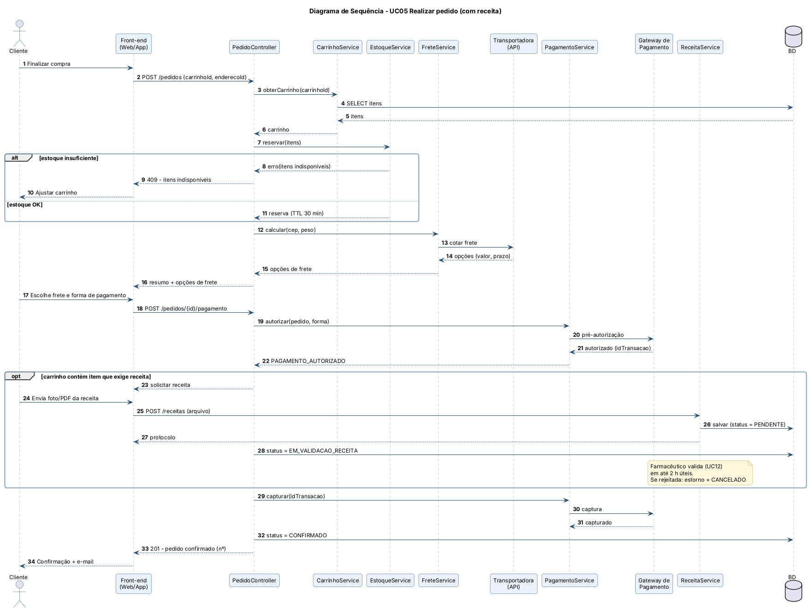
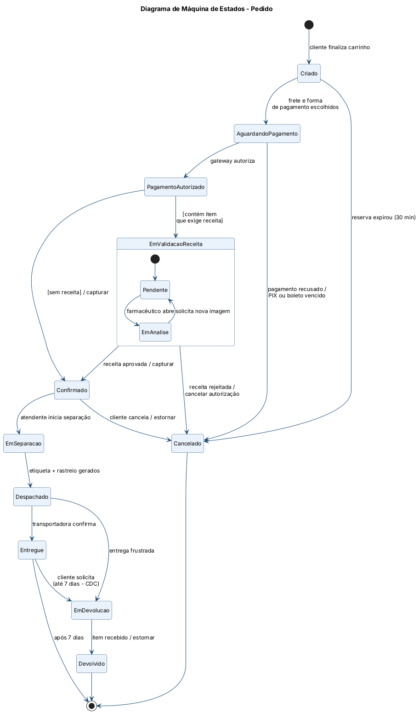

# Etapa 5 – Projeto

## Diagrama de classes

Herança de `Usuario` (Cliente, Funcionario → Farmaceutico, Atendente, Administrador) e de `Produto` (Medicamento, ProdutoGeral). `Pedido` compõe `ItemPedido` e se associa a `Receita`, `Pagamento`, `Entrega`, `Cupom` e `Endereco`. `Lote` controla validade para FEFO.

## Diagrama de sequência – UC05 Realizar pedido com receita

Reserva de estoque (alt), cotação de frete, pré-autorização do pagamento, envio de receita (opt) e captura após aprovação do farmacêutico.

## Máquina de estados – Pedido

Criado → Aguardando pagamento → Pagamento autorizado → Em validação de receita → Confirmado → Em separação → Despachado → Entregue; desvios para Cancelado e Em devolução → Devolvido.
